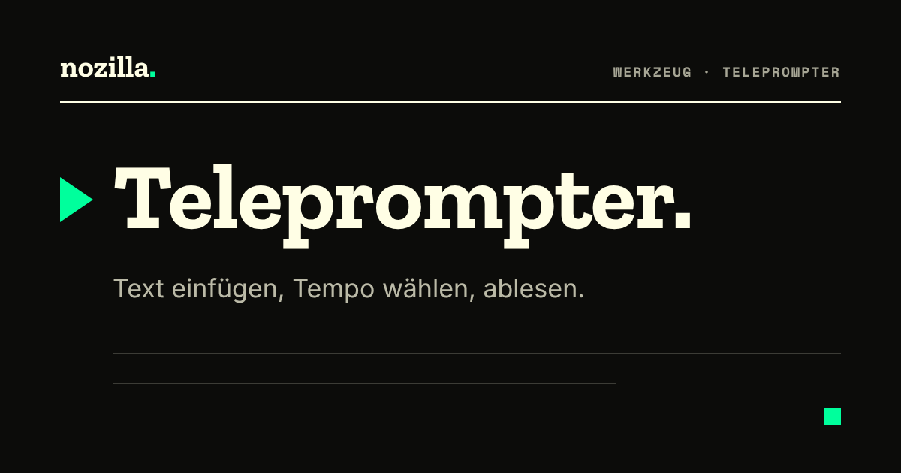

# nozilla Teleprompter

Text einfügen, Tempo wählen, ablesen. Ein Teleprompter im Browser, gestaltet nach dem [nozilla CI](https://daimpad.github.io/nozilla-ci/ci/).

**Live:** https://daimpad.github.io/nozilla-teleprompter/

## Bedienung

| Taste | Wirkung |
|---|---|
| Leertaste | Start und Stopp |
| → / ← | schneller / langsamer |
| ↑ / ↓ | Schrift größer / kleiner |
| Esc | zurücksetzen |

Den Text direkt auf der Seite bearbeiten oder einfügen. Er bleibt im Browser gespeichert. Oben lassen sich Schrift- und Hintergrundfarbe wählen, und für Aufbauten mit Spiegelglas lässt sich der Text horizontal und vertikal spiegeln. Einstellungen stehen in der Adresse und lassen sich so als Link weitergeben.

## Was nozilla gegenüber dem Original geändert hat

- **Gestaltung:** nozilla Design System (dunkles Theme, fester Stand über jsDelivr), eigene Icons im nozilla-Raster statt Font Awesome, Regler ohne jQuery-UI-Fremdtheme, deutsche Texte, eigene App-Icons und Vorschaubild.
- **Entfernt:** die Fernsteuerung per Handy samt Node-Server und Docker. Ohne sie läuft die App rein statisch, zum Beispiel auf GitHub Pages. Ebenfalls entfernt: Google Analytics.
- **Behoben:**
  - Die App schrieb die Adresse auf die Domain-Wurzel um, sodass ein Neuladen unter einem Unterpfad ins Leere führte.
  - Jede Bewegung am Regler erzeugte einen Eintrag im Browserverlauf.
  - Der Service Worker lieferte die Seite immer aus dem Cache, Updates kamen nie an. Jetzt gilt: Netz zuerst, der Cache dient nur für offline.

## Lokal starten

```bash
python3 -m http.server 8080
# http://localhost:8080
```

> **Herkunft:** Dieses Repository basiert auf [TelePrompter](https://github.com/manifestinteractive/teleprompter) von Peter Schmalfeldt / Manifest Interactive, übernommen mit vollständiger Versionsgeschichte (Stand `develop`, inhaltlich Version 1.2.2). Der Code steht unter der doppelten **MIT- und GPL-Lizenz** des Originals, siehe [LICENSE](./LICENSE). Anpassungen von nozilla stehen unter denselben Bedingungen.
>
> Ausgeliefert wurde bisher unter `code.nozilla.net/teleprompter/` — byte-gleich mit dem Original.

---

## Original-README (englisch)

Project Support
===

If you or your company enjoy using this project, please consider supporting my work and joining my discord. 💖

[](https://github.com/sponsors/manifestinteractive)
[](https://patreon.com/peter_schmalfeldt)
[](https://www.paypal.me/manifestinteractive)
[](https://discord.gg/jW7RemFSzx)

------

TelePrompter
===

> Browser-based TelePrompter with Remote Control



Features
---

- [X] Edit Text in Browser
- [X] Changes Saved Automatically
- [X] Handy Keyboard Shortcuts
- [X] Advanced Controls
- [X] Remote Control Support

Free to Use
---

Our Open Source TelePrompter is Available Online:

[](https://promptr.tv)

Keyboard Shortcuts
---

Key              | Alternatives                            | Description
:---------------:|:---------------------------------------:|:--------------------------
<kbd>↑</kbd>     |                                         | Increase Font Size
<kbd>↓</kbd>     |                                         | Decrease Font Size
<kbd>←</kbd>     | <kbd>PAGE UP</kbd>                      | Slow Down Teleprompter
<kbd>→</kbd>     | <kbd>PAGE DOWN</kbd>                    | Speed Up Teleprompter
<kbd>SPACE</kbd> | <kbd>B</kbd> <kbd>F5</kbd> <kbd>.</kbd> | Start / Stop Teleprompter
<kbd>ESC</kbd>   |                                         | Resets GUI

We also made an effort to make sure your text will be easy to read.   So if you are pasting text from a word document, we'll do some cleaning up to make the breaks flow more easily.
